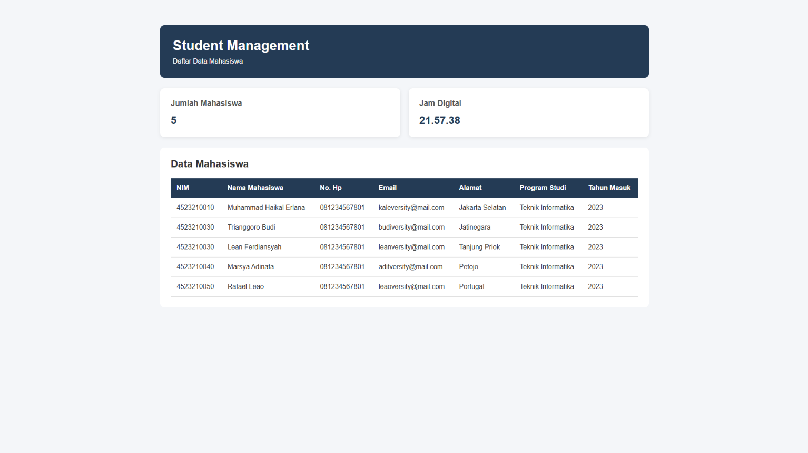

# Student Management

Aplikasi **Student Management** merupakan implementasi antarmuka sederhana menggunakan ReactJS untuk menampilkan data mahasiswa dalam bentuk tabel. Proyek ini dibuat sebagai bagian dari tugas **Frontend Individual Challenge – React UI Implementation Practice** dari Celerates.

## Preview Aplikasi

Berikut merupakan tampilan aplikasi Student Management yang telah dibuat menggunakan ReactJS.



> **Catatan:** Simpan screenshot aplikasi dengan nama `student-management-preview.png` di dalam folder `screenshots` pada direktori utama proyek agar gambar dapat ditampilkan di GitHub.

## Teknologi yang Digunakan

- **ReactJS** – Library JavaScript untuk membangun antarmuka pengguna.
- **JavaScript** – Bahasa pemrograman yang digunakan dalam pengembangan aplikasi.
- **Vite** – Build tool untuk menjalankan dan mengembangkan proyek React.
- **Vanilla CSS** – Digunakan untuk mengatur tampilan dan tata letak aplikasi.

## Fitur Aplikasi

1. **Menampilkan Data Mahasiswa**  
   Menampilkan data mahasiswa dalam bentuk tabel yang terdiri dari NIM, Nama Mahasiswa, No. Hp, Email, Alamat, Program Studi, dan Tahun Masuk.

2. **Jumlah Mahasiswa**  
   Menampilkan jumlah keseluruhan data mahasiswa yang tersedia.

3. **Jam Digital (Live Clock)**  
   Menampilkan waktu secara langsung dan diperbarui setiap satu detik menggunakan `useEffect`, `useState`, dan `setInterval`.

4. **Data Mahasiswa dengan React State**  
   Data mahasiswa disimpan menggunakan `useState` dan ditampilkan secara berulang menggunakan `.map()`.

## Struktur Folder

```text
Student-Management/
├── public/
├── screenshots/
│   └── student-management-preview.png
├── src/
│   ├── App.jsx
│   ├── App.css
│   └── main.jsx
├── index.html
├── package.json
├── package-lock.json
├── vite.config.js
└── README.md
```

## Cara Menjalankan Aplikasi

Pastikan Node.js dan npm sudah terpasang pada komputer.

1. Clone repository:

   ```bash
   git clone URL_REPOSITORY
   ```

2. Masuk ke direktori proyek:

   ```bash
   cd Student-Management
   ```

3. Install dependencies:

   ```bash
   npm install
   ```

4. Jalankan aplikasi:

   ```bash
   npm run dev
   ```

5. Buka alamat lokal yang muncul pada terminal, biasanya:

   ```text
   http://localhost:5173
   ```

## Informasi Tugas

- **Program:** Celerates
- **Module:** Frontend Development
- **Task:** React UI Implementation Practice
- **Mentor:** Ahmad Thomthomi Barosimi

---

**Student Management – React UI Implementation Practice**